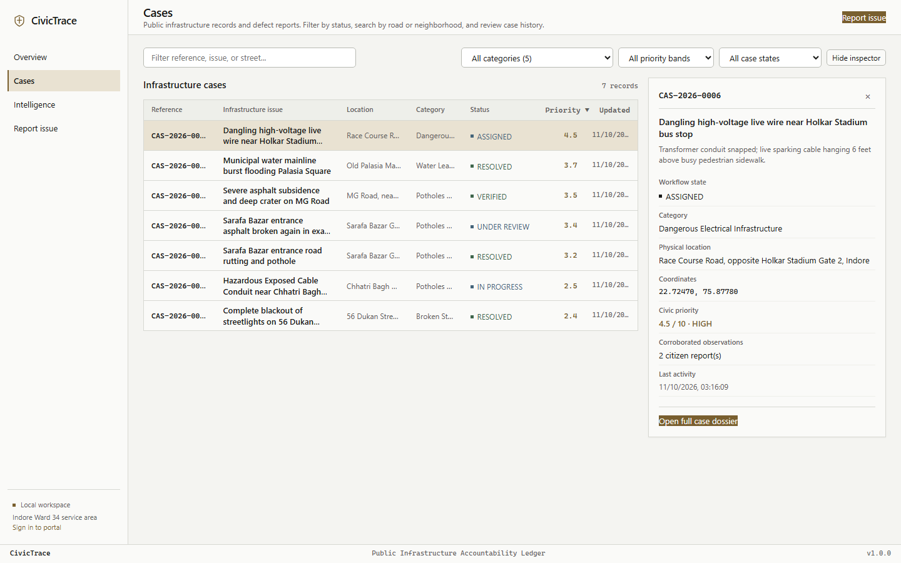
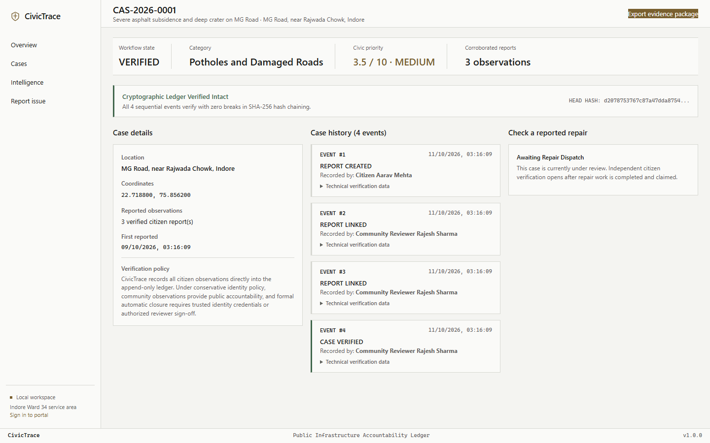
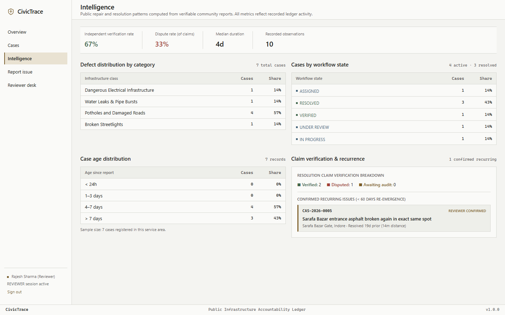
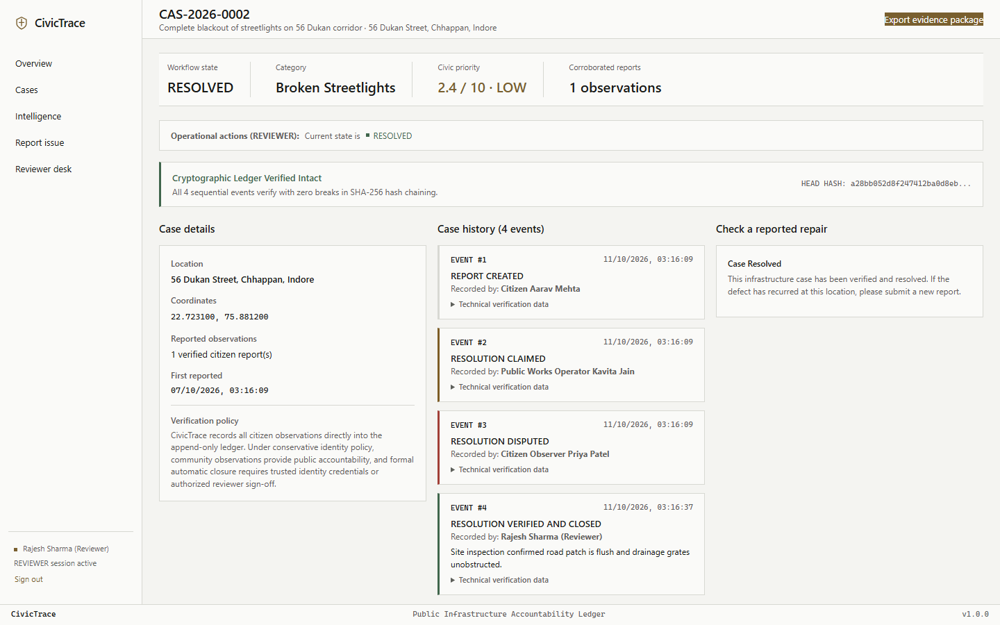

# CivicTrace

> A public record of problems worth fixing.

CivicTrace is an open-source, evidence-oriented civic infrastructure investigation system. Traditional municipal ticketing tools allow issues to disappear into an unverifiable "Closed" status. CivicTrace replaces opaque ticket updates with an **append-only cryptographic event ledger**, **deterministic spatial-textual duplicate correlation**, and **independent citizen verification gates**.

Built for WarriorHacks 2.0 under the theme of civic infrastructure accountability.

---

## System Overview

```
                      +---------------------------------------+
                      |       Citizen & Official Portal       |
                      |   (React 19 + TypeScript + Vite)      |
                      +-------------------+-------------------+
                                          |
                                HTTP / REST API (FastAPI)
                                          |
                      +-------------------v-------------------+
                      |          CivicTrace API Core          |
                      |  - State Machine Governance           |
                      |  - Deterministic Duplicate Engine     |
                      |  - Priority Band Calculator           |
                      |  - Cryptographic Signer & Ledger      |
                      +---------+-------------------+---------+
                                |                   |
                 +--------------+                   +-------------+
                 |                                                |
    +------------v-------------+                    +-------------v-------------+
    |   Database Persistence   |                    |   Evidence Storage        |
    | - SQLite (Local / Demo)  |                    | - Local Storage / Uploads |
    | - PostgreSQL + PostGIS   |                    | - SHA-256 Verified Assets |
    |   (Production / Cluster) |                    | - Tamper-Evident Packages |
    +--------------------------+                    +---------------------------+
```

### Visual Interface & Screenshots

CivicTrace follows the **Workshop + Gridline + Studio Utility** visual identity: dense, functional layouts, baseline grids, subtle borders, and monospace data labels.

| Case Explorer | Cryptographic Case Ledger |
| :---: | :---: |
|  |  |

| Neighborhood Intelligence | Resolution Dispute Workflow |
| :---: | :---: |
|  |  |

---

## Core Differentiators

| Standard Complaint Ticketing | CivicTrace Evidence Platform |
| :--- | :--- |
| **Disappearing Tickets:** Departments mark issues "Closed" with no verification. | **Citizen Verification Gate:** Operator-claimed repairs enter `Awaiting Verification`. Under conservative policy, auto-closure requires trusted identity credentials; otherwise, authorized reviewer sign-off is required. |
| **Scattered Duplicate Reports:** Multiple citizens report the same defect; each creates a separate ticket. | **Deterministic Duplicate Engine:** Automatically correlates reports via Haversine distance, token similarity, and category weights into consolidated cases with preserved provenance. |
| **Opaque Status Changes:** Timestamps and status history can be silently edited in the database. | **Tamper-Evident Cryptographic Ledger:** Every status change, assignment, work claim, and inspection is chained via SHA-256 hashes (Schema v2 canonicalization). Modifying historical rows breaks cryptographic verification. |
| **Memoryless History:** Potholes repaired poorly break open again in weeks; previous tickets are gone. | **Chronic Recurrence Intelligence:** Automatically identifies and links recurring defects re-emerging at the same coordinates within 60 days. |
| **Proprietary Data Silos:** Data trapped inside vendor systems. | **Portable Evidence Packages:** Exports self-contained ZIP evidence bundles containing JSON audit logs, evidence files, and SHA-256 integrity manifests with optional Ed25519 digital signatures. |

---

## Quick Start (Local Development)

CivicTrace requires zero paid APIs, zero cloud AI subscriptions, and no mandatory Docker containers for development.

### Prerequisites
- **Python 3.11+**
- **Node.js 18+ & npm**

### 1. Backend Setup

```bash
# 1. Clone repository and navigate to root:
git clone https://github.com/Rhythm-Sanghi/CivicTrace.git
cd CivicTrace

# 2. Create and activate a Python virtual environment:
python -m venv .venv
# On Windows (PowerShell):
.\.venv\Scripts\Activate.ps1
# On Linux / macOS:
source .venv/bin/activate

# 3. Install backend dependencies:
pip install -r services/api/requirements.txt

# 4. Initialize environment configuration:
cp .env.example .env

# 5. Seed demonstration accounts and scenarios:
cd services/api
python -m app.db.seed

# 6. Start the FastAPI development server:
uvicorn app.main:app --reload --port 8000
```

The interactive OpenAPI documentation is available at `http://localhost:8000/api/v1/docs` (ReDoc: `http://localhost:8000/api/v1/redoc`).

---

### 2. Frontend Setup

In a separate terminal window:

```bash
cd apps/web

# 1. Install dependencies:
npm install

# 2. Start the Vite development server:
npm run dev
```

The CivicTrace web application will be accessible at `http://localhost:5173`.

---

### 3. Database Migrations

CivicTrace uses Alembic for declarative schema migrations:

```bash
cd services/api
alembic upgrade head
```

- **Local Demo & Development:** Table creation is supported via SQLite (`AUTO_CREATE_TABLES=True` in `.env`).
- **Production Mode:** Alembic migrations (`alembic upgrade head`) are strictly authoritative. The production startup gate enforces `AUTO_CREATE_TABLES=False`.

---

## Demonstration Accounts

When seeded locally, CivicTrace includes 5 interconnected civic infrastructure scenarios set in Indore Central Ward (illustrative data):

| Role | Email | Password | Purpose |
| :--- | :--- | :--- | :--- |
| **Community Reviewer** | `reviewer@civictrace.local` | `ReviewerPass2026!` | Moderation queue, duplicate adjudication, and rework dispatch |
| **Public Works Operator** | `lighting.operator@civictrace.local` | `OperatorPass2026!` | Work assignment, in-progress logging, and resolution claims |
| **Citizen Observer** | `citizen.aarav@civictrace.local` | `CitizenPass2026!` | Defect reporting and independent site verification |
| **Administrator** | `admin@civictrace.local` | `AdminPass2026!` | Department administration and identity enrollment |

> **Security Note:** In local development mode, the sign-in view displays one-click buttons for demo accounts. In production builds (`import.meta.env.PROD === true`), all demo credentials and one-click controls are stripped from compiled assets by bundler dead-code elimination. The backend database seeder (`seed.py`) refuses to run when `ENVIRONMENT=production`.

---

## Automated Verification & Testing

CivicTrace maintains a comprehensive test suite across backend unit/integration tests, frontend component tests, and Chromium browser end-to-end automation.

### Backend Test Suite (Pytest)

```bash
cd services/api
pytest app/tests -v
```

**77/77 tests passing** across two test configurations:
- **SQLite Engine Runner:** Validates in-memory and file-based state machine transitions, SHA-256 ledger chaining, multi-process sequence allocators, rate limiting, and backup recovery.
- **PostgreSQL & PostGIS Runner:** Executed against PostgreSQL 16 in CI (`backend-postgres-test`). Validates PostgreSQL dialect behavior, role boundaries, partial unique index constraints (`uq_active_resolution_claim_per_case`), cross-session token revocation, concurrent ledger writes, and schema migrations from empty to populated schemas.

Key test areas:
1. **Ledger Integrity & Attack Vectors (13 tests):** SHA-256 hash chaining, Schema v2 canonicalization, actor identity modification detection, timestamp backdating detection, event reordering, and Ed25519 signature verification.
2. **Workflow Concurrency Races (8 tests):** Concurrent duplicate candidate approval, approval vs rejection race, assignment vs transition race, multiple concurrent resolution claims, observation races, and ledger appends.
3. **Backup & Recovery Security (7 tests):** Coordinated database and evidence snapshots, encrypted key backup lifecycle (AES-256-GCM + PBKDF2), corrupted archive detection, and uncommitted file handling.
4. **Access Control & Safety (15 tests):** Department boundaries, operator self-verification blocking, CSRF Double Submit token validation, HttpOnly cookie authentication, rate limiting, and destructive test target prevention.
5. **Credential & Seeding Isolation (2 tests):** Confirms demo seeding refuses production environments and production JavaScript builds exclude demo credentials.

### Frontend Component Tests (Vitest)

```bash
cd apps/web
npm run test
```

**8/8 tests passing**, covering layout rendering, accessible landmarks, 320px viewport stacking, design tokens, session storage isolation, and production credential suppression.

### Frontend Linter (oxlint)

```bash
cd apps/web
npm run lint
```

**0 errors, 0 warnings** across all 20 source files.

### End-to-End Browser Lifecycle (Playwright)

```bash
python scripts/run_browser_e2e.py
```

Executes a 14-step workflow in headless Chromium on a clean database:
1. Citizen registration and portal login
2. Defect report submission and evidence upload
3. Quarantine of pending reports from unauthorized public view
4. Reviewer moderation approval and public case creation
5. Case verification and department assignment
6. Operator sign-in and progress transition
7. Formal resolution claim submission (`Awaiting Verification`)
8. Citizen inspection and dispute filing (`Disputed`)
9. Closure blocked while dispute is unresolved
10. Reviewer dispute adjudication and rework dispatch
11. Subsequent repair claim and confirmation (`Resolved`)
12. Signed evidence archive export and offline verification
13. Session logout and revoked token replay rejection
14. Security & accessibility checks: foreign operator rejection (HTTP 403), archive tampering detection, 320px viewport rendering, keyboard tab navigation, and 200% zoom scaling.

---

## Operational Tooling

CivicTrace includes a unified command-line tool for atomic backups, recovery, and key lifecycle management (`scripts/backup_restore.py`):

```bash
# 1. Create atomic coordinated backup of database and evidence (TAR.GZ archive):
python scripts/backup_restore.py backup --out backups/civictrace_backup.tar.gz --db services/api/civictrace_dev.db --uploads services/api/storage/uploads

# 2. Restore and verify an atomic backup:
python scripts/backup_restore.py restore --archive backups/civictrace_backup.tar.gz --target-dir ./restored --expected-public-key <BASE64_PUBLIC_KEY>

# 3. Create encrypted backup of signing keys (PBKDF2-HMAC-SHA256 + AES-256-GCM):
python scripts/backup_restore.py backup-keys --out keys_backup.enc --passphrase-env KEY_BACKUP_PASSPHRASE

# 4. Restore encrypted signing keys:
python scripts/backup_restore.py restore-keys --archive keys_backup.enc --passphrase-env KEY_BACKUP_PASSPHRASE --target-dir ./keys

# 5. Rotate Ed25519 signing key with automatic backup:
python scripts/backup_restore.py rotate-key --keyfile services/api/storage/keys/signing_key.hex

# 6. Clean up interrupted upload fragments:
python scripts/backup_restore.py cleanup-interrupted --uploads services/api/storage/uploads --db services/api/civictrace_dev.db --dry-run
```

*Note on archive formats: Operational system backups use `.tar.gz` archives with integrity manifests. Case evidence exports generated via the API or web portal use portable `.zip` archives with JSON timelines and SHA-256 asset manifests.*

---

## Release Readiness

| Tier | Status | Rationale |
| :--- | :--- | :--- |
| **Local Demo** | **READY** | Zero external dependencies; SQLite atomic sequences, 77 automated backend tests, 8 frontend tests, 14-step Chromium verification, and offline Indore map schema work out of the box. |
| **Hackathon Demo** | **READY** | Fully functional evidence lifecycle, append-only cryptographic ledger, tamper detection, reviewer moderation desk, and responsive Workshop UI. |
| **Private Pilot** | **CONDITIONALLY READY** | Requires PostgreSQL 16 + PostGIS container, production environment configuration (`ENVIRONMENT=production`), dedicated external keypair storage, and reverse proxy with TLS termination. |
| **Public Production** | **NOT READY** | Accepted limitations: requires distributed multi-node rate limiting (e.g. Redis), official municipal single sign-on / national ID integration (e.g. DigiLocker / Aadhaar / eID), anti-DDoS / WAF protection, and virus scanning on uploaded binary assets. |

---

## Contributing & License

CivicTrace is licensed under the **Apache License, Version 2.0**. See [`LICENSE`](LICENSE) for full terms.

Issues, bug reports, and pull requests should be submitted against the `main` branch. All pull requests must pass the complete GitHub Actions CI pipeline (SQLite tests, PostgreSQL migrations and integration tests, frontend lint and build, and Playwright Chromium E2E).
